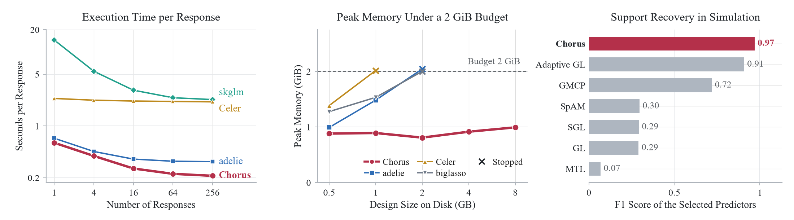
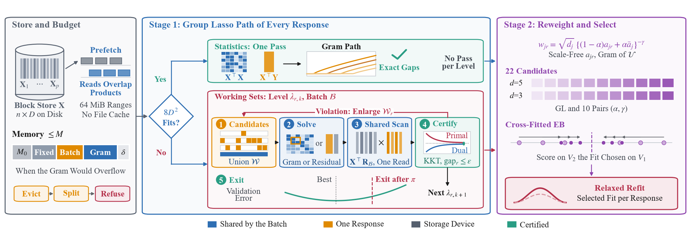
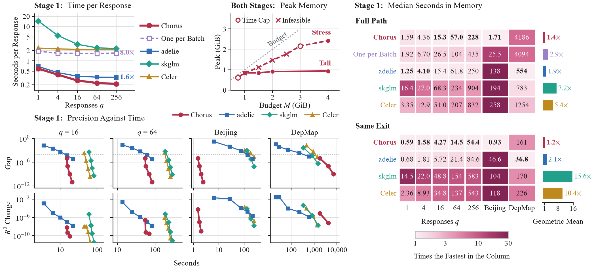
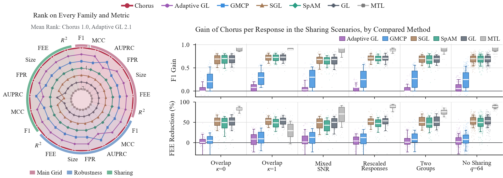
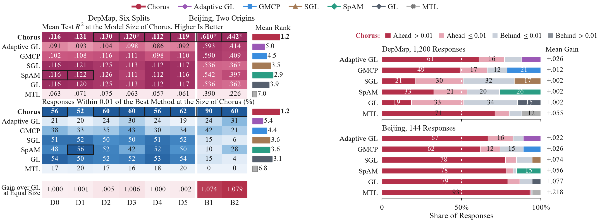
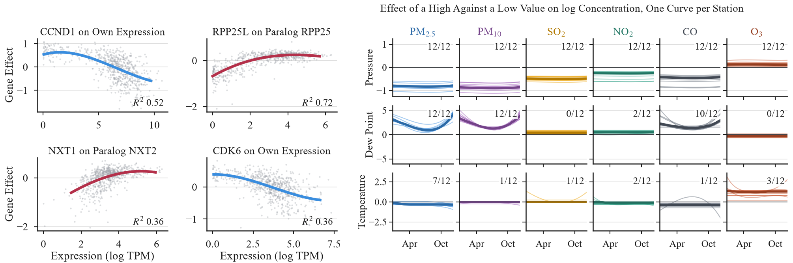
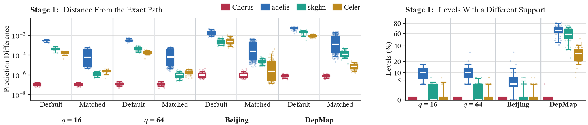
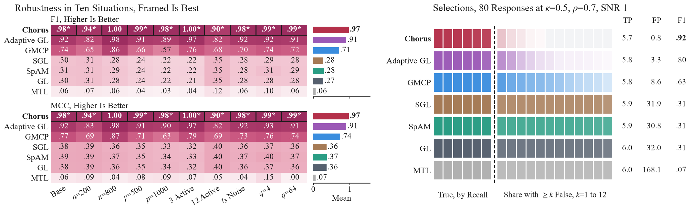
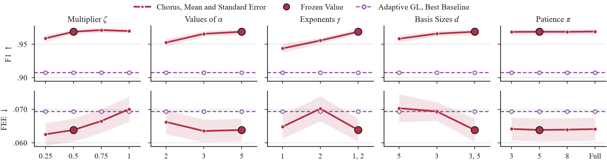

<div align="center">



# Chorus

**Batched Learning of Many Sparse Additive Models under Memory Constraints**

[](LICENSE)
[](requirements.txt)
[](#installation)

<samp>

[**Overview**](#overview) · [**Architecture**](#system-architecture) · [**Results**](#principal-results) · [**Installation**](#installation) · [**Usage**](#usage) · [**Reproducibility**](#reproducibility) · [**Structure**](#repository-structure) · [**Data**](#data-availability)

</samp>

</div>

---

## Overview

Many analytical workloads fit one model per response over a shared feature table. A cancer
dependency map, for example, relates the knockout effect of every gene to the same expression
profiles. Existing solvers for sparse additive models treat such a workload as a loop over
responses: they reread the design for each response, do not bound their memory and ignore the
predictors that responses share.

**Chorus** (Concurrent Hierarchical Optimization of Responses Under Space constraints) fits many
sparse additive models together within a stated memory bound, as a chorus sings many voices from
one score.

<table>
<tr>
<td width="33%" valign="top">

**Shared Scans**

One pass over the design forms the sufficient statistics when the Gram matrix fits the budget.
Otherwise one scan serves a whole batch of responses, and a duality gap certifies every solution.

</td>
<td width="33%" valign="top">

**Stated Memory Bound**

A ledger charges every array to a bound on the resident memory of the process, and the design may
stay on disk. An oversized working set is evicted, split or reported as infeasible.

</td>
<td width="33%" valign="top">

**Cross-Response Selection**

A second stage borrows strength across responses. A cross-fitted empirical Bayes rule selects each
fit from validation data alone, and a relaxed refit removes the shrinkage on the selected support.

</td>
</tr>
</table>

---

## System Architecture



Stage 1 computes the certified group lasso path of every response, from one-pass statistics when
the Gram matrix fits the budget and otherwise with shared-scan working sets. Stage 2 reweights,
selects and relaxes the fit of every response.

---

## Principal Results

The measurements below use one BLAS thread on a 6-core Intel Core i7-8700 with 16 GB of RAM and a
SATA solid-state disk. Bold marks the best value of each row.

### Execution Efficiency

Median seconds of stage 1, with the same validation-aware exit for every solver. Each external
solver runs through its standard interface at the cheapest tolerance whose paths reach a relative
duality gap of 10<sup>−4</sup>.

| Workload | Chorus | adelie | skglm | Celer |
| --- | ---: | ---: | ---: | ---: |
| Simulated, 16 responses | **4.27** | 5.72 | 48.8 | 34.8 |
| Simulated, 64 responses | **14.5** | 21.4 | 154 | 137 |
| Simulated, 256 responses | **54.4** | 84.6 | 583 | 543 |
| Beijing air quality, 72 responses | **0.93** | 46.6 | 104 | 118 |
| DepMap, 64 dependencies | 161 | **36.8** | 170 | 226 |

Shared scans and validation-aware exit together make the certified paths of 256 responses 8.0
times faster than one response at a time. On a short and wide table such as DepMap, batching saves
nothing and adelie remains faster.



### Memory Bound

Fits of 64 responses with the design on disk and a budget of 2 GiB, both stages included. Every
compared solver stops at the budget or at the time cap on the largest designs.

| Training rows | 25,000 | 50,000 | 100,000 | 200,000 | 400,000 |
| --- | ---: | ---: | ---: | ---: | ---: |
| Design size | 0.5 GB | 1 GB | 2 GB | 4 GB | 8 GB |
| Minutes | 4.8 | 7.4 | 10.2 | 25.7 | 53.9 |
| Peak memory (GiB) | 0.88 | 0.89 | 0.81 | 0.92 | 0.99 |

### Statistical Accuracy

Means over the 100 cases of the main simulation grid, with six active predictors per response.

| Metric | Chorus | Adaptive GL | GMCP | SGL | SpAM | GL | MTL |
| --- | ---: | ---: | ---: | ---: | ---: | ---: | ---: |
| F1 score | **0.969** | 0.908 | 0.719 | 0.292 | 0.296 | 0.290 | 0.069 |
| Matthews correlation | **0.970** | 0.913 | 0.746 | 0.376 | 0.380 | 0.374 | 0.066 |
| False positive rate | **0.0015** | 0.0073 | 0.0326 | 0.1711 | 0.1681 | 0.1723 | 0.8590 |
| Function estimation error | **0.064** | 0.069 | 0.074 | 0.125 | 0.116 | 0.127 | 0.198 |
| Test R² | **0.614** | 0.611 | 0.608 | 0.578 | 0.583 | 0.577 | 0.532 |



### Real Workloads

Mean test R² at the model size of Chorus, for DepMap 24Q4 pooled over six splits and for the
Beijing network at two time origins (B1 and B2).

| Workload | Chorus | Adaptive GL | GMCP | SGL | SpAM | GL | MTL |
| --- | ---: | ---: | ---: | ---: | ---: | ---: | ---: |
| DepMap | **0.120** | 0.094 | 0.108 | 0.117 | 0.117 | 0.117 | 0.065 |
| Beijing B1 | **0.610** | 0.593 | 0.590 | 0.536 | 0.542 | 0.536 | 0.390 |
| Beijing B2 | **0.442** | 0.414 | 0.409 | 0.367 | 0.397 | 0.362 | 0.226 |

At the size each method selects for itself, denser models reach a higher raw test R² when the
signal of a response is spread over many predictors: MTL reaches 0.133 on DepMap with 862 genes per
dependency, and SpAM reaches 0.616 and 0.492 on Beijing with 36 predictors.





<details>
<summary><b>Additional Figures</b></summary>

<br>

<div align="center">
<br>
<b>Agreement with the Exact Path</b><br>
<sub>Prediction difference at default and matched tolerances, and path levels with a different support.</sub>
</div>

<br>

<div align="center">
<br>
<b>Robustness and Selections</b><br>
<sub>F1 score and Matthews correlation under ten settings, and the selections of 80 responses in one setting.</sub>
</div>

<br>

<div align="center">
<br>
<b>Sensitivity of the Configuration</b><br>
<sub>One choice varied at a time on the main grid, mean and standard error, with adaptive GL as reference.</sub>
</div>

</details>

---

## Installation

```bash
pip install -r requirements.txt
```

The baselines implemented in R require R 4.5 with grpreg 3.6.0, sparsegl 1.1.1, SAM 1.3, biglasso
1.7.2 and jsonlite.

## Usage

```python
import sys
sys.path.insert(0, 'src')
import numpy as np
from chorus import Chorus, InMemoryDesign, SplineDesign

rng = np.random.default_rng(0)
n, n_val, p, q = 400, 200, 100, 8
x = rng.uniform(-1, 1, (n + n_val, p))
y = np.zeros((n + n_val, q))
shared = rng.choice(p, 3, replace=False)
for r in range(q):
    active = np.r_[shared, rng.choice(p, 3, replace=False)]
    for j in active:
        y[:, r] += rng.normal(1, .3) * np.sin(2 * x[:, j] + rng.uniform(0, 3))
y += .7 * rng.normal(size=y.shape)

basis = SplineDesign().fit(x[:n])            # cubic B-splines fitted on the training rows
X = basis.transform(x)
y -= y[:n].mean(axis=0)
train = InMemoryDesign(X[:n], basis.groups)
val = InMemoryDesign(X[n:], basis.groups)

model = Chorus(memory_budget=2 << 30).fit(train, y[:n], val, y[n:])
pred = model.predict(val)                    # n_val x q
print(model.support_.sum(axis=0))            # selected predictors per response
```

`DiskDesign` and `write_disk_design` keep the design on disk behind the same interface.

## Reproducibility

All commands run from the root of the repository. The correctness tests are

```bash
python -m pytest tests
```

The tables and Figures 1 to 3 regenerate from the committed summaries within minutes and without
raw data.

```bash
python tools/table_ooc_a25.py
python tools/table_accuracy_a25.py
python tools/table_real_a25.py
python tools/table_sensitivity_a25.py
python tools/tables_a26.py
python tools/figs/fig_workflow_v10.py fig1
python tools/figs/fig_efficiency_v23.py fig2
python tools/figs/fig_accuracy_v9.py results/v2/sim_a22.csv results/v2/sim_a22_per_response.csv results/v2/fig3_selection.json fig3
```

The full experiments take several days on one machine and require the [data](#data-availability).
Generated cases are written to `results/cases` and fitted paths to `results/real_a22`, and neither
is part of this repository. Figure 4 reads those fitted components, so it follows the real-data
runs: `python tools/figs/fig_real_v15.py results/v2/matched_size_per_response.csv fig4`.

| Stage | Scripts |
| --- | --- |
| Out-of-core cases | `tools/make_disk_cases.py`, `tools/make_stress_case.py`, `tools/make_wide_cases.py` |
| Tuning, on tuning seeds only | `tools/tune_selection.py`, `tools/tune_a22.py`, `tools/freeze_config.py` |
| Simulations | `tools/run_sim_grid.py` with `configs/grids/*.json`, then `tools/rerun_a22.py` |
| Real workloads | `tools/run_real_a22.py`, `tools/eval_depmap.py`, `tools/matched_size.py` |
| Timing | `tools/make_timing_plan3.py`, `tools/run_timing.py` with `configs/timing_plan3_*.json` |
| Certificates | `tools/certify_sweep.py`, `tools/sweep_agreement.py`, `tools/exit_losses.py` |
| Summaries | `tools/collect_sim_a22.py`, `tools/collect_sim_a22_pr.py`, `tools/collect_real_a22.py` |
| Ablation and sensitivity | `tools/ablation_a22.py`, `tools/sensitivity_a22.py` |
| Numbers of the text | `tools/numbers_a21.py`, `tools/numbers_a22.py`, `tools/numbers_a22_real.py` |

Tuning used seeds 101 to 103 only, and the reported simulations use seeds 1001 to 1005.
`configs/chorus_frozen_a22.json` records the frozen configuration and the SHA-256 hash of
`src/chorus/*.py`, which matches this repository. `docs/protocol_amendments.md` records every change
made after freezing, with its motivation and evidence.

## Repository Structure

```
src/chorus/         block store, batched path engine, statistics path, memory ledger, cost model,
                    reweighting, selection and relaxed refit
src/bench/          case format, isolated Python and R workers, memory-sampling runner, evaluation
src/data/           simulation generator, DepMap and Beijing case builders
tools/              experiment drivers, collectors, tables and numbers
tools/figs/         generators of the figures
configs/            frozen configuration, simulation grids and timing plans
results/            summary tables of the runs and timing logs
manuscript/tables/  generated tables
tests/              agreement with skglm, batched against single-response fits, disk against
                    memory, update strategies and memory ledger
docs/               figures of this page and protocol amendments
```

## Data Availability

- **DepMap 24Q4** (figshare 27993248): `CRISPRGeneEffect.csv`, `CRISPRInferredCommonEssentials.csv`,
  `OmicsExpressionProteinCodingGenesTPMLogp1.csv` and `Model.csv`, with paralog pairs from Ensembl
  BioMart. `src/data/depmap.py` builds the cases.
- **Beijing Multi-Site Air Quality** (UCI 501, CC BY 4.0). `src/data/beijing.py` builds the cases.

## Baseline Implementations

| Method | Estimator | Implementation |
| --- | --- | --- |
| GL | Group lasso for sparse additive models | adelie 1.1.52 |
| Adaptive GL | Two-stage adaptive group lasso | adelie 1.1.52 |
| GMCP | Group minimax concave penalty | grpreg 3.6.0 |
| SGL | Sparse group lasso | sparsegl 1.1.1 |
| SpAM | Sparse additive model | samQL of SAM 1.3 |
| MTL | Multi-task lasso | biglasso 1.7.2 |

skglm 0.5 and Celer 0.7.4 compute the group lasso for the comparison of execution efficiency.
SAM places spline knots at training quantiles, so predictors in which one value covers more than 5%
of the training rows receive a deterministic jitter of 10<sup>−6</sup> standard deviations
(`src/bench/r_worker.R`). biglasso fits its multi-task model on blocks of 40 responses for DepMap,
with one shared penalty level per block, because one joint fit of 200 responses exceeded the memory
of the test machine.

## Authors

Xuanwu Wang, Baicheng Pan, Lixian Tan, Xiao Ke, Qishi Dong and Bingding Huang

## License

This project is released under the [MIT License](LICENSE).
